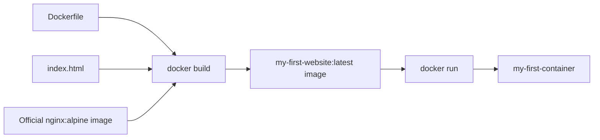

# Architecture: Docker Web App

This project packages a static website with Nginx. It has one application container, no backend API, and no database. The diagrams describe the intended setup; use the verification commands to check your current machine.

## Build flow



Run from the project root:

```powershell
docker build -t my-first-website .
```

Docker uses the current folder as the build context. The Dockerfile selects the Nginx base image and copies only `index.html` into it. README and architecture documentation are not copied into the resulting website image by this Dockerfile.

## Request flow

```mermaid
flowchart TD
    subgraph Windows[Windows 11 computer]
        A[Browser: localhost:8080] --> B[Host binding: 127.0.0.1:8080]
        subgraph Desktop[Docker Desktop Linux environment]
            subgraph Container[my-first-container]
                C[Nginx: port 80] --> D[/usr/share/nginx/html/index.html]
            end
        end
        B -->|Published TCP port| C
    end
    D -->|HTML response via Nginx| A
```

Create the container only if its name is unused:

```powershell
docker ps -a --filter "name=^/my-first-container$"
```

```powershell
docker run -d --name my-first-container -p 127.0.0.1:8080:80 my-first-website
```

The browser requests the host's port 8080. Docker forwards the connection to Nginx on container port 80. Nginx reads the packaged HTML and returns it. The browser executes the page's JavaScript; the click counter is not server-side state.

## Components and responsibilities

| Component | Responsibility |
| --- | --- |
| `index.html` | Contains the page, embedded styles, and click-counter JavaScript. |
| `Dockerfile` | Defines the base image and where to copy the website. |
| `my-first-website:latest` | Packaged Nginx environment and a snapshot of the HTML. |
| `my-first-container` | Instance of that image, with its own runtime state. |
| Docker Desktop | Provides the Linux engine environment on Windows. |
| Port mapping | Connects a chosen host address and port to the container's listening port. |

## Lifecycle and verification

```text
docker build → image
docker run   → new container, then start it
docker stop  → stopped container; image remains
docker start → same container running again
```

```powershell
docker images
docker ps
docker ps -a
docker logs my-first-container
Invoke-WebRequest -Uri 'http://localhost:8080' -UseBasicParsing
```

A successful verification combines a running container, the expected port mapping, HTTP `200`, and the intended page content. A running process alone does not establish that the right website is served.

## Interview checkpoints

- **Dockerfile vs image vs container:** instructions, packaged result, and runtime instance.
- **Alpine:** a minimal Linux distribution used by this Nginx image variant. It is not a separate VM inside the container.
- **Build vs runtime:** `COPY` executes while building. Nginx starts when the container starts.
- **`RUN` vs `CMD`:** `RUN` executes build-time commands; `CMD` specifies a default runtime command. This project inherits startup behavior from the base image.
- **`EXPOSE` vs `-p`:** `EXPOSE` documents intended ports; `-p` publishes a host port. Adding `EXPOSE` alone does not create the mapping.
- **Host vs container ports:** 8080 belongs to the host binding; 80 is where Nginx listens inside the container.
- **Localhost:** inside a container, it refers to that container. In your Windows browser, it refers to your computer.
- **Updating the site:** rebuild the image and create a new container from it. Starting an old container does not switch it to a newly built image.
- **Persistence:** stop/start preserves a container's writable layer. Replacing a container does not transfer that layer; durable application data needs a separate storage plan.

## How a larger application differs

For a future Next.js and FastAPI project, each application can have its own Dockerfile, image, and container. A shared Docker network lets server-side code address other containers by name. Browser JavaScript needs a browser-accessible API URL or a server-side proxy; it cannot use Docker-only hostnames directly.

That is a future exercise. This repository runs only the static Nginx website.

See the [README](README.md) for Windows setup, command explanations, and troubleshooting.
